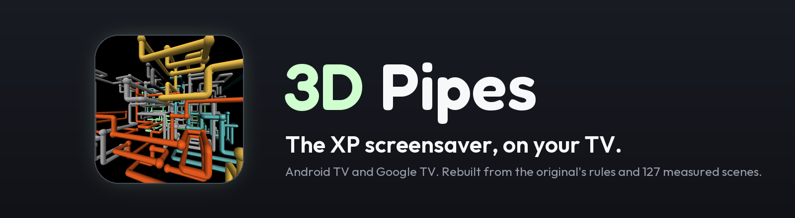
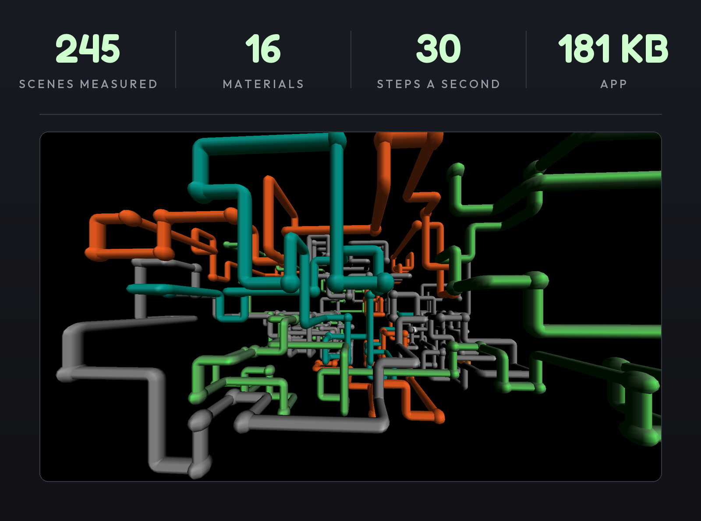
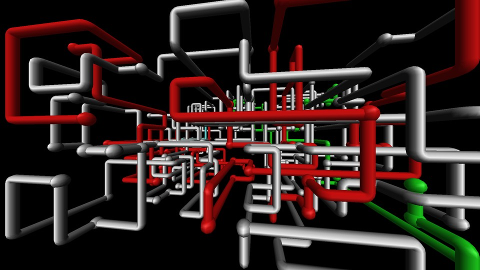
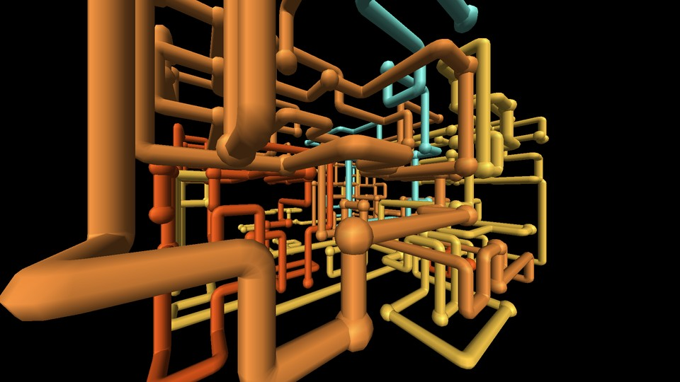
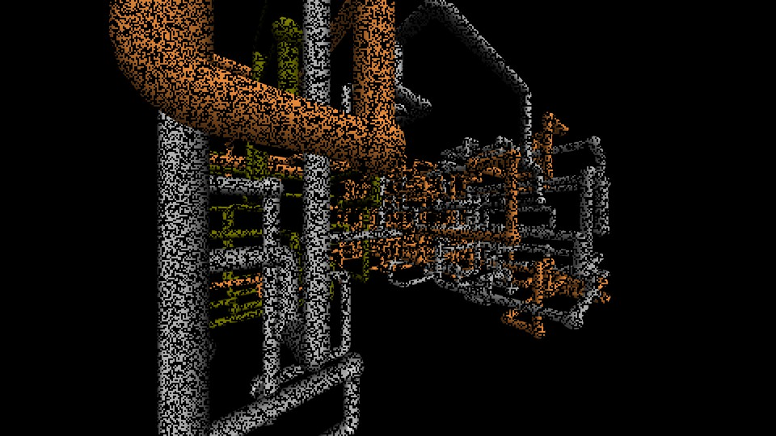
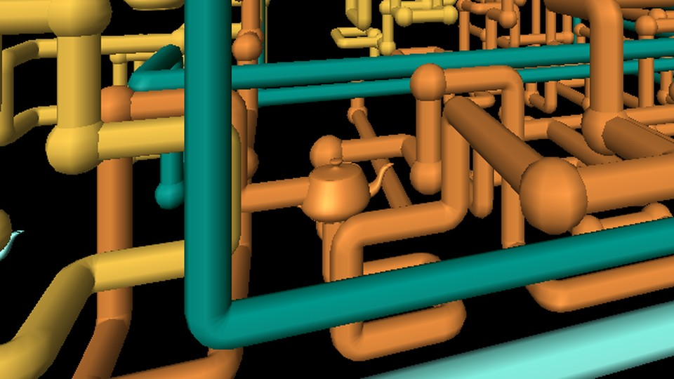

  

  
  
  
  
  

  

**3D Pipes: XP Screensaver for Android TV** is the classic 3D Pipes screensaver as a native screensaver for Android
TV and Google TV. It follows the original program's own rules, checked against 184 scenes of the real thing.

*Not affiliated with or endorsed by Microsoft. "Windows" and the original screensaver belong to Microsoft. This
project contains no Microsoft code, images or sounds.*

## How it works

Pipes grow through a 3D lattice, one whole segment at a time, 30 steps a second:

1. **A scene starts** with one pipe at a random free spot, in one of 16 classic materials.
2. **Each step**, the pipe goes straight or turns 90 degrees into a free node, as a tight elbow or a ball
   joint (about one turn in three is a ball). It never doubles back and never enters a node it has used.
3. **A trapped pipe** ends in a ball and a new one starts somewhere else, until five have run.
4. **When the last pipe is trapped**, small black squares eat the picture, the view turns 9.73 degrees, and the
   next scene begins.

**No internet permission, no settings screen, nothing running when the screensaver is not on.**

How each rule and number was established, and what was corrected along the way, is in
[docs/REFERENCE_ANALYSIS.md](docs/REFERENCE_ANALYSIS.md).

## Quick start

You need a computer with the Android SDK on the same Wi-Fi as the TV.

| | |
|---|---|
| **1. On the TV** | Settings → System → About → press OK on **Android TV OS build** seven times → back → Developer options → **USB debugging** on. Turn on Network or Wireless debugging too if you see it. |
| **2. On your computer** | `adb connect <tv-ip>`, then build and install: `gradlew assembleRelease` and `adb install -r app/build/outputs/apk/release/app-release.apk`. Accept "Allow USB debugging?" on the TV. |
| **3. Make it the screensaver** | `adb shell settings put secure screensaver_components io.github.thewombraider.pipestv/.PipesDream` and `adb shell settings put secure screensaver_enabled 1`. |

The app also puts a **3D Pipes** tile in the launcher that runs the same scene in a window, to preview it. The
release build is signed with the debug key and is meant for sideloading.

**TCL TVs: allow auto-start once.** TCL firmware stops the system from starting a sideloaded app's screensaver; the
TV goes to "Dreaming" with nothing on screen, and the log shows
`TclAppBoot: forbid bind service ... callee_doesn't_have_OP_AUTO_START_permission`. Allow it once; it survives
updates:

    adb shell cmd appops set io.github.thewombraider.pipestv AUTO_START allow

Undo with `AUTO_START default`. This was needed on a TCL 75T7 (Google TV, Android 14).

## What you get

- **The original's rules**: a lattice shaped to your screen (15 x 8 x 15 on a 16:9 TV), pipes that prefer to run
  straight, one at a time, and scenes that end when the last pipe is trapped, not on a timer.
- **The original's look**: 8-sided pipes with smooth shading, balls one and a half pipes across, elbows as tight as
  the pipe, and no smoothing on the edges, as OpenGL 1.1 drew them.
- **The 16 classic materials**, emerald to white rubber, each with its own highlight, lit per vertex by one light
  at the upper right.
- **The level camera** with a 90 degree view, turning 9.73 degrees with each scene.
- **Ball joints and elbows mixed**, about one turn in three a ball, as the original does it, and the rare
  **Utah teapot** in place of a joint.
- **The clear**: small black squares in random order over about 1.7 seconds.

| | |
|---|---|
|  |  |
| *A finished scene* | *Close up: tight elbows, ball joints at the turns* |
|  |  |
| *The clear, part way through* | *A teapot in place of a joint* |

## How faithful it is

Microsoft published the source of 3D Pipes as an OpenGL sample in the Windows NT 4.0 SDK. This app follows that
program's rules, read from [SspipesSharp](https://github.com/RussDev7/SspipesSharp), a port of the sample (facts only,
no code copied). Five public recordings, 184 complete scenes, were then measured frame by frame to check each rule
and to settle what the source leaves to the machine. An independent reviewer tried to refute every finding; its
verdicts and the corrections are in [docs/reference/SKEPTIC.md](docs/reference/SKEPTIC.md).

Where the recordings disagree, this app follows the ones that match the original program's code and the way the
screensaver is remembered: one pipe at a time, mixed joints, light from the upper right. Details and numbers:

- **Ball joints**: 1 turn in 3, the code's value. Two blind counters measured 0.30 (0.28 to 0.33) in the footage
  after correcting for their bias on renders of known share ([docs/reference/JOINTS.md](docs/reference/JOINTS.md)).
- **Teapot turns**: 1 in 1000, the code's rate. The footage agrees once the teapots the counters miss are allowed for.
- **Speed**: 30 steps a second. Single-pipe scene lengths fit 29.2 (28.0 to 30.5); the original's speed depended on
  the machine.
- **Light**: from the upper right, as in the code and one family of recordings. Four recordings are lit from above.
- **Clear**: 1.7 s in small squares, as in that same family. Four recordings fade in about half a second.

## Performance

Recorded on a TCL 75T7 (MediaTek, Mali-G52). Results vary by scene and device.

| Metric | Recorded result |
|---|---|
| Pipe growth | 30 whole segments per second per growing pipe |
| Time between growth frames | About 33.3 ms |
| Longest frame gap | 50 ms, at the pause between scenes |
| App CPU, median | 10 % of one core |

The app draws a frame only when the picture changes. It is designed for budget streaming sticks, but testing so
far covers the TCL and an Android emulator; sticks such as the Chromecast with Google TV HD and onn 4K have not
been tested. Measurements were collected with [`tools/frame_timing.py`](tools/frame_timing.py).

## For developers

**Build and test**: `gradlew testDebugUnitTest lintRelease`. The tests cover the growth rules (whole segments, no
reused nodes, bounds, scene length against the reference model, pipe counts, materials, joint modes), the camera's
clearance at every turn, and the shapes (sizes, outward-facing triangles, elbow rims that meet the pipe, a whole
teapot).

**Launch options**: the preview activity takes extras for testing, all clamped:
`--es pipes single|multiple --es joints mixed|elbow|ball --ef ball 0.333 --ef turn 0 --ef teapot 0.001
--ef timescale 1 --ef dissolve 1.7 --ef hold 0.033 --ef stress 1`. Debuggable builds log frame and scene statistics under the tag
`XPPipes`.

**Tools**:

- `tools/reference/`: the footage measurements (`frame_stats.py`, `scenes.py`) and a model of the rules
  (`sim_model.py`).
- `tools/capture_at.py`: screenshots a finished scene on an emulator.
- `tools/frame_timing.py`: frame timing and CPU on a device.
- `tools/score_frames.py`: ranks candidate screenshots.
- `tools/make_readme_art.py`: draws the banner, card and screenshots.
- `tools/gen_teapot.py`: builds `teapot.bin` offline from pinned classic SGI/GLAUX data.
- `tools/test_teapot.py`: checks the geometry against an independent source-data evaluator.
- [Teapot source and QA](tools/teapot/README.md): provenance, inspection fixtures, and validation.

## Credits and license

MIT, see [LICENSE](LICENSE). Third-party material and credits are in [NOTICE](NOTICE): the original's rules as
documented by SspipesSharp, the classic OpenGL teapot materials, Martin Newell's Utah teapot in its classic SGI/GLAUX form
(with the SGI source notice and earlier three.js MIT notice preserved), and the look of the Clean Your TV README.
