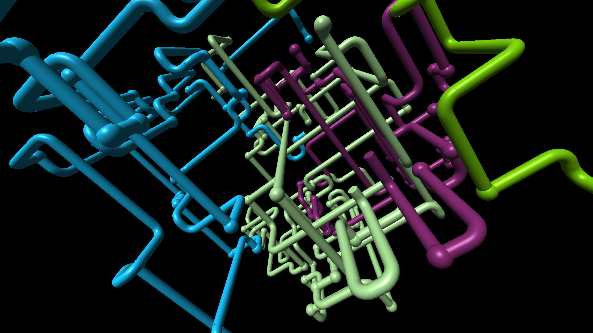

# pipes-tv

A screensaver for Android TV and Google TV that recreates the Windows 3D Pipes screensaver in real-time OpenGL ES 2.0.

*Not affiliated with or endorsed by Microsoft. "Windows" and the original screensaver belong to Microsoft. This project
contains no Microsoft code, images or sounds; it was written from observation of public footage.*

## What it does

A scene starts with one pipe. It grows through a small 3D lattice, going straight about half the time and turning
90 degrees otherwise, as either a rounded elbow or a ball joint, never entering a node a pipe has used. A new pipe
joins about every 7 seconds, each in its own random colour. Pipes that run out of room end in a ball. The camera is
fixed for the scene and chosen fresh for the next. After 18 to 34 seconds the frozen picture dissolves to black pixel
by pixel over 1.6 seconds and a new scene begins. Rarely a joint is the Utah teapot.

It has no internet permission and no settings screen.

## Install

    gradlew assembleDebug testDebugUnitTest
    adb install -r app/build/outputs/apk/debug/app-debug.apk
    adb shell settings put secure screensaver_components io.github.thewombraider.pipestv/.PipesDream
    adb shell settings put secure screensaver_enabled 1

The app also adds a "3D Pipes" entry to the launcher that runs the same scene in a window, to preview it.
(The launcher entry is signed with the debug key, so it installs over a debug build and is meant for sideloading.)

### TCL TVs: allow auto-start once

TCL firmware blocks the system from binding a sideloaded app's screensaver service. The log shows
`TclAppBoot: forbid bind service ... callee_doesn't_have_OP_AUTO_START_permission` and the TV goes to "Dreaming"
with nothing on screen. Allow it once; it survives reinstalls:

    adb shell cmd appops set io.github.thewombraider.pipestv AUTO_START allow

Undo with `... AUTO_START default`. This was needed on a TCL 75T7 (Google TV, Android 14).

## How faithful is it

The look and timing were measured from [3d Pipes Screensaver 10 Hours](https://youtu.be/tCpnDTzRAjE) by DoctorDothraki;
the findings, and which are observed and which are estimated, are in [docs/REFERENCE_ANALYSIS.md](docs/REFERENCE_ANALYSIS.md).
Known limits:

- The lattice size (15), tube radius (0.17), field of view (65 degrees), camera distance (9 to 13) and growth speed
  (12 units a second) are estimates calibrated against a handful of frames, not read from the original's code.
- Scene lengths were measured over about five minutes of a ten-hour recording.
- No teapot was found in the sampled frames; the 1-in-1000 rate comes from the original's documented behaviour.
- Tested on one TV (TCL 75T7, MediaTek, 2.4 GB) at 54 to 60 fps, and on an Android 14 emulator.

## Launch options (for testing)

The preview activity accepts extras, all clamped to safe ranges:
`--ei grid 15 --ef radius 0.17 --ef fov 65 --ef dmin 9 --ef dmax 13 --ef dissolve 1.6 --ef timescale 1 --ef teapot 0.001`.
Frame statistics are logged under the tag `XPPipes` on debuggable builds only.

## Tests

`./gradlew testDebugUnitTest` runs the growth rules (no reversing, no reused nodes, bounds, clearing, determinism, the
pipe schedule, colours, speed, bad lattice sizes) and the geometry (cylinder, sphere, elbow, the teapot asset).
`tools/capture_at.py` screenshots an emulator at a chosen scene age for side-by-side comparison with reference frames.
`tools/gen_teapot.py` regenerates `teapot.bin` from three.js's teapot data.

## Credits and licence

MIT; see [LICENSE](LICENSE). Third-party material and credits are in [NOTICE](NOTICE): the growth rules follow
[1j01/pipes](https://github.com/1j01/pipes) (MIT) and the teapot comes from three.js's `TeapotBufferGeometry`
(MIT, Eric Haines), from Martin Newell's Utah teapot data.
