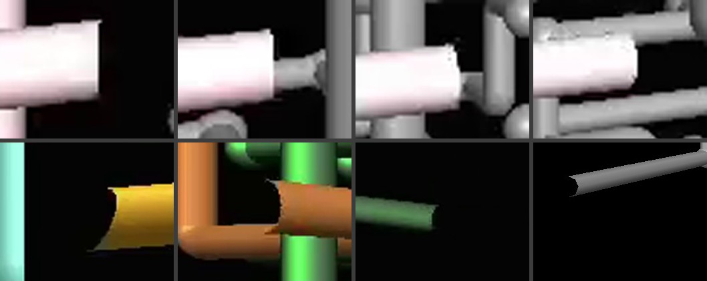

# Pipe head shape: audit

Date: 2026-10-23. Status: **audited; no change to the app.**

Baseline: `3223bc1`. The question: in the original, does the front end of a pipe that is still growing look
rounded, like half a sphere on the end of the tube? This app draws it flat. If the original is rounded, add the
cap.

## What the app does

A pipe grows one lattice segment per tick (docs/REFERENCE_ANALYSIS.md, Speed). Each segment is a `RUN` piece:
a tube from one radius past the node it leaves to one radius short of the node it enters (`PipeSim.addRun`).
The joint at that next node (elbow, ball or teapot), or the next straight run, is made on the following tick,
when the pipe chooses where to go.

The renderer draws a run with `Meshes.cylinder(SIDES, false)`: a tube with no end caps, with back faces culled.
So between two ticks, the front of a growing pipe is a bare cut end one radius short of the node. Seen from the
side it is a straight edge, square to the pipe. Seen from the front, the tube is open: the inner faces are
culled, so the cut shows as a dark crescent.

**Confirmed:** the app's growing head is flat and open.

## What the original does

Source: the 60-minute single-pipe recording (tCpn), which matches the original's code in every other measured
rule. Near-camera growth was found from the frame-difference statistics: 57 runs of at least four consecutive
ticks where a pipe grows across the screen. The leading end was cut out of each frame at native resolution and
enlarged, then followed across consecutive ticks.

- **Top row:** one white pipe over four consecutive ticks, seen almost side-on. The end is a straight edge
  with sharp corners. Its slight curve is the rim of a flat end seen a little from the front. A hemisphere
  would stick out by a whole pipe radius, as a half circle.
- **Bottom row, first three:** heads at other angles. The yellow and orange ends show the same dark crescent as
  the app: the original's tube is open at the head too. The green end is flat.
- **Bottom right:** this app, for comparison.

In all eight sequences sampled from the 57, no growing head has a dome. The rounded ends that do appear in the
recording are joints: elbows where the pipe turned into the run, and balls, which are 1.53 times as wide as the
pipe. A first pass mistook the elbow at the trailing end of a new run for a domed head. Following the same run
over consecutive ticks corrected that.

## Decision

The app already matches the original, so it stays as it is. A hemispherical head cap was built and tested
(a dome mesh whose rim meets the tube's vertex for vertex, drawn per frame at each growing pipe's front end).
It worked on the emulator, but it is not in the original, so it was removed. If a rounded head is ever wanted
as a deliberate departure, that version is a small change: one shared buffer of six oriented domes and one draw
per growing pipe, with no change to the scene buffer's bound.
