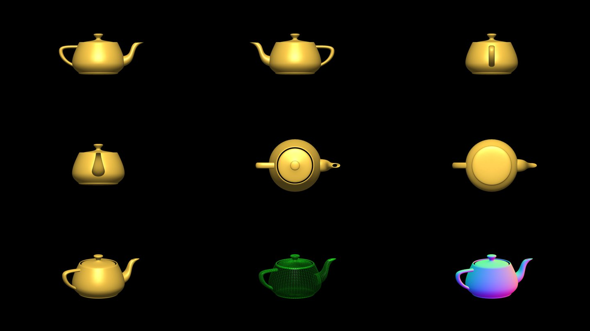
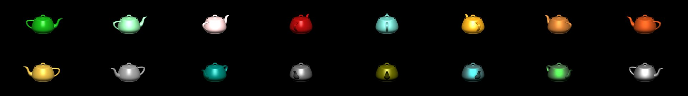

# Teapot QA

Evidence for the teapot rebuild described in
[the teapot spec](design/2026-10-21-teapot-fidelity-design.md). Source, transforms and limits are in
[tools/teapot/README.md](../tools/teapot/README.md).

## Model and asset

| Check | Result |
|---|---|
| Model | Utah teapot, classic 32-patch SGI/GLAUX variant: 10 base patches, 127 control points |
| Source | `glut_teapot.c` at markkilgard/glut `8cd96cb`, SHA-256 `c2831b3b…`, vendored in `tools/teapot/` |
| GLAUX cross-check | `TEAPOT.H` at tdechaize/Glaux `78dfb19`: every patch index and coordinate matches |
| Transform | GLAUX's 270 degree X rotation, half scale and -1.5 Z offset; caller scale 2.5 pipe radii |
| Tessellation | 14 intervals per patch edge, as GLAUX's `solidTeapot(14, scale)`: 7,200 vertices, 12,432 triangles |
| Removed | The three.js lid enlargement (7.7 %) and its height normalization |
| Kept | The historic lid gap and the intersecting handle, spout and body |
| Asset | `teapot.bin`, SHA-256 `8ffa0d1b…`; every Android build checks the source, data and asset hashes |

## Numerical checks

`tools/test_teapot.py` evaluates the original C tables with Bernstein polynomials, independently of the
generator's de Casteljau evaluator: every stored vertex and normal, every patch, reflected topology, shared patch
edges, random interior points, outward body normals, packed-normal precision and byte-identical regeneration.
Largest stored-position error: 5.95e-08 source units. Smallest dot product between stored and reference normals:
1.000000000000. The Java tests cover the asset parser (truncated, oversized, out-of-range and non-finite input
is rejected), the camera's clearance around a teapot at the lattice edges, both ways a teapot appears, and scene
buffer capacity.

## Views

Debug-build fixture, one teapot, gold, orthographic: front, back, left, right, top, bottom, oblique, wireframe,
normals.

All 16 materials:

No cracks, missing or inverted faces, or clipping. The dark ring in the top view is the lid gap of the historic
model, not a defect.

## Runs

Android 14 emulator (`sdk_gphone64_x86_64`, 1920 x 1080, software rendering), debug build, started
2026-10-22 00:55 UTC:

| Run | Length | Scenes | Most teapots at once | Memory (PSS) | Frame intervals |
|---|---|---|---|---|---|
| Normal mixed joints | 30 min | 163 | 1 | 46.0 to 52.9 MB, flat after the first minute | median 33.1 ms, p95 46.4 ms |
| Every turn a teapot | 10 min | 33 | 598 | 46.9 to 51.6 MB, flat | median 116 ms, p95 281 ms |

No crashes, GL errors or fallbacks to the sphere. The forced run puts hundreds of 12,432-triangle teapots on
screen at once, which the emulator's software renderer cannot draw at 30 frames a second; it is a stability
test, not a speed target. In normal play a teapot is rare.

## Not yet verified

- **The TCL TV.** The update is installed, but the on-screen captures and timing runs on the TV were not done,
  because they would light the screen at night. Run `tools/teapot_qa.py --serial <tv>` with a debug build, and
  `tools/frame_timing.py`, during the day.
- **Exact XP data.** The model matches published SGI and GLAUX tables. Microsoft's shipped XP binary was not
  compared, and no rasterization detail of a period driver is reproduced.
